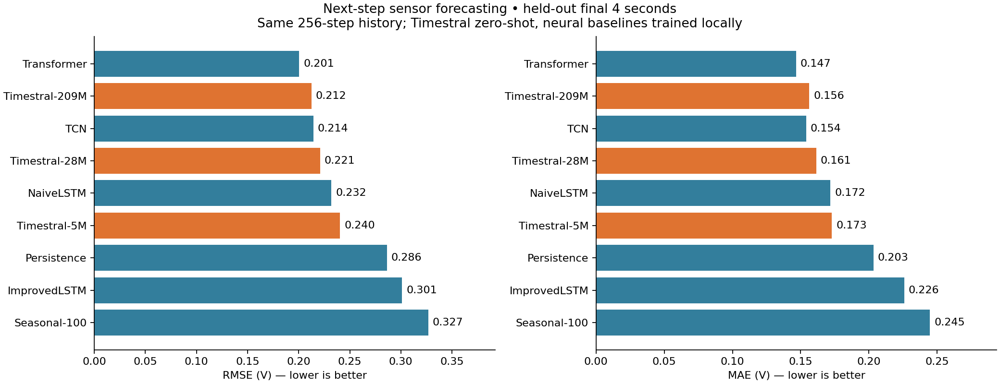
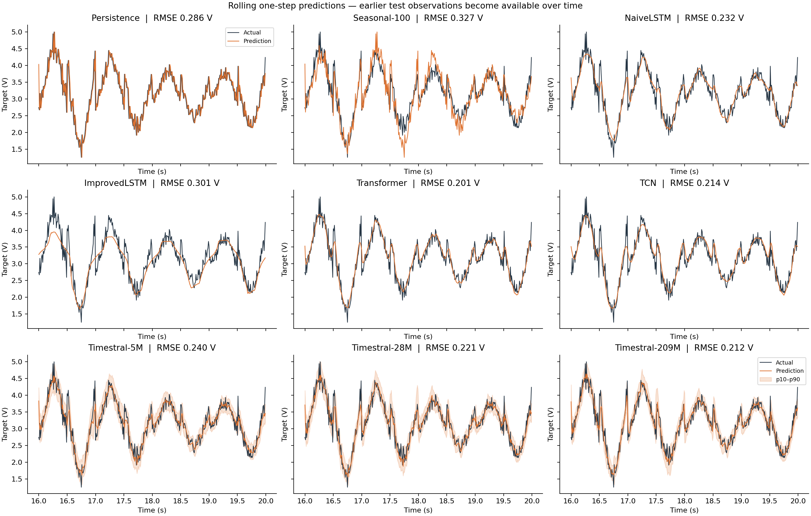
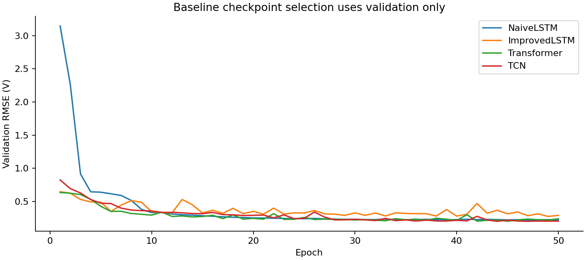

# Timestral on the synthetic sensor benchmark

Run date: October 16, 2026. Hardware: NVIDIA GeForce RTX 4090, PyTorch 2.8.0+cu128.

Timestral works locally in this repo with no API key. The zero-shot 209M model came close to the best locally trained model on this small next-step forecasting task, but did not beat it. These results compare actual downloaded weights, not a stand-in implementation.

## Reproduce

From this worktree (or a checkout containing these changes):

```bash
uv sync --extra timestral --frozen
uv run --extra timestral --frozen python src/compare_timestral.py --device cuda
PYTHONPATH=src uv run --extra timestral --frozen python -m unittest discover -s tests -v
```

GPU is the default and fails explicitly if unavailable. Use `--device cpu` for a CPU run. Downloads are cached by Hugging Face (`HF_HOME` can override its location). The code and model revisions are pinned. `--epochs`, `--seed`, `--sizes`, `--threads`, and `--output` expose the benchmark's few run controls. Defaults: 50 epochs, seed 42, sizes 5M/28M/209M, four CPU threads. The 123M option is supported but was not evaluated in this report.

Outputs go to `artifacts/timestral/`: `metrics.csv`, per-timestep `predictions.csv`, `run.json`, three plots, and four baseline state dictionaries. This directory contains a durable copy of the report's plots, predictions, metrics and manifest. The existing `src/train.py` Ray/ONNX pipeline is unchanged.

## Protocol

- Read the committed 2,000-row `data/input/data_signals.csv`; 100 Hz sampling.
- Train targets: rows 256–1199 (944 windows). Validation targets: rows 1200–1599 (400 windows). Test targets: rows 1600–1999 (400 windows, 16.00–19.99 s).
- Every forecast predicts the next target using exactly the preceding 256 observations (2.56 seconds) of sine, square, triangle and target. No current/future target or future sensor readings enter the forecast.
- Test evaluation rolls forward one sample at a time: earlier test observations become available as history. This is **one-step (10 ms) forecasting**, not a four-second open-loop forecast.
- Reuse the repository's four neural architectures with `input_size=4`, retrained from scratch. Fit input standardization on the first 1,200 rows only. Select checkpoints by lowest validation RMSE; test values never select weights or hyperparameters. Adam, learning rate 0.001, batch size 64. ImprovedLSTM retains gradient clipping and its plateau scheduler.
- Timestral receives raw target history plus three past-only covariates, uses its native normalization and median prediction, and receives no local fine-tuning. p10–p90 provides a nominal 80% interval.
- Persistence repeats the last target; Seasonal-100 repeats the target one second earlier (100 samples, chosen from the known generator period).

This intentionally differs from the older README experiment: historical targets are now available to **all learned models**, and validation and test are separate. Old saved three-channel checkpoints and old validation scores are not used.

## Measured results

Lower error is better. Scores are volts in the existing synthetic dataset's scale.

| Model | Test RMSE | Test MAE |
|---|---:|---:|
| Transformer | 0.2006 | 0.1466 |
| Timestral-209M | 0.2124 | 0.1563 |
| TCN | 0.2143 | 0.1540 |
| Timestral-28M | 0.2210 | 0.1613 |
| NaiveLSTM | 0.2320 | 0.1718 |
| Timestral-5M | 0.2405 | 0.1729 |
| Persistence | 0.2864 | 0.2033 |
| ImprovedLSTM | 0.3012 | 0.2259 |
| Seasonal-100 | 0.3268 | 0.2448 |

Timestral-209M reduced RMSE by about 25.8% relative to persistence and 8.5% relative to NaiveLSTM. Its RMSE was about 5.9% higher than the trained Transformer's. The tiny RMSE difference from TCN is not evidence of a reliable advantage; TCN has slightly better MAE.





The shaded regions are Timestral's p10–p90 intervals. Empirical coverage was 82.75% (5M), 82.50% (28M), and 84.50% (209M), against the nominal 80%; mean widths were 0.575, 0.557, and 0.520 V respectively. This measures coverage on these 400 correlated observations, not calibration across other datasets.



The ImprovedLSTM underfit this run. The architecture's name does not guarantee better results; its attention pooling can be a poor fit for this very short-horizon task with a fixed training budget. That explanation is a hypothesis, not an ablation result.

## Timing and interpretation

`metrics.csv` records local training and total warmed inference time for all 400 test windows. Neural batches use 64 windows; Timestral batches use 16. Timings include Python batching and CPU/GPU transfers, exclude model download/loading and warmup, and are single measurements rather than standardized kernel or single-request latency benchmarks. Pretraining cost is not included in Timestral's zero local-training time. Persistence/seasonal inference timings are unmeasured (blank).

The trained baselines are much smaller (13k–150k parameters) than Timestral (5.2M–209.3M). Timestral's attraction here is useful forecasts without task-specific training plus uncertainty intervals, rather than winning either accuracy or inference speed outright.

Limits: one synthetic realization, one training seed, one short test segment, overlapping contexts, and no significance estimates. The original generator rescales each complete signal with full-series minimum/maximum before this benchmark reads it; this pre-existing property limits strict deployment realism even though benchmark standardization is train-only. This is not evidence of real-world sensor generalization, multi-step performance, or an exhaustively tuned baseline ranking. Foundation-model pretraining exposure cannot be independently audited here.

## Small model on CPU

A follow-up ran the same pinned Timestral-5M weights on an Intel Core i9-14900K with four PyTorch threads, using the same 400 test windows and sensor covariates. CPU RMSE was **0.24045 V** (MAE 0.17287 V); the largest median-prediction difference from GPU was 0.00000314 V.

After warmup, three passes over all 400 windows at batch size 16 took 4.483, 4.131, and 4.467 seconds (median **4.47 seconds**). Twenty separate batch-size-one calls had median latency **24.2 ms**, with a 24.7 ms 95th percentile. These calls repeated the first test window; this is a small local latency measurement rather than a general hardware benchmark. Loading and warmup are excluded. The runtime was explicitly verified to use CPU parameters.

The [CPU measurement receipt](cpu/run.json) and [CPU predictions](cpu/predictions.csv) preserve the result. The distribution consists of `config.json` plus `model.safetensors`, loaded by the official Python/PyTorch implementation. This integration does not export Timestral to ONNX or a standalone executable.

## Sources

- [Mistral announcement](https://mistral.ai/news/timestral/)
- [Official inference implementation at the pinned commit](https://github.com/mistralai/timestral/tree/a534bdbd244d64f3d9d743f46c7bf6fc330ed4ff)
- [Official model collection](https://huggingface.co/collections/mistralai/timestral)

The inference code is Apache-2.0; weights have a separate Modified MIT license. See the upstream model cards for terms.
