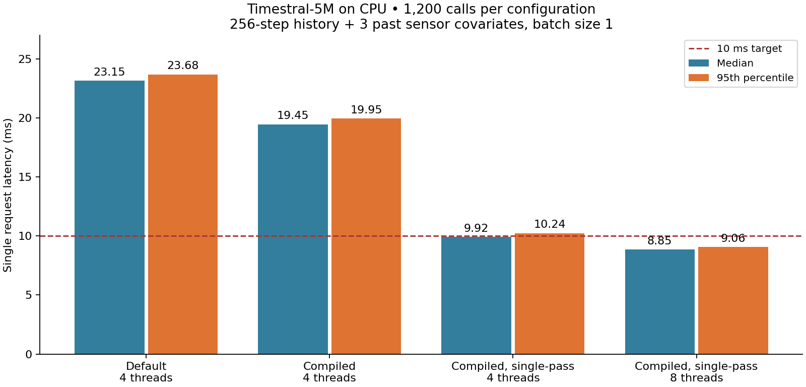

# Timestral-5M CPU latency investigation

This follow-up targets a single next-step forecast below 10 ms on the local Intel Core i9-14900K. It retains the 256-observation history, all three past sensor covariates, and the pinned 5M weights. No fine-tuning, quantization, shorter history or omitted sensors are used in the final candidate.

The upstream default performs two model passes: one on the input and one on its negation, then combines reflected quantiles. The adapter now exposes the upstream `symmetric_averaging` option; its default remains `True`. Setting it to `False` deliberately changes forecasts. Compilation wraps only the model's transformer stack and leaves input validation, normalization and quantile processing in the upstream implementation.

## Reproduce

Run from this checkout, after installing the Timestral extra and caching the weights via the original comparison:

```bash
uv run --extra timestral --frozen python src/benchmark_timestral_latency.py --threads 4 --output artifacts/latency/default
uv run --extra timestral --frozen python src/benchmark_timestral_latency.py --threads 4 --compile --output artifacts/latency/compiled
uv run --extra timestral --frozen python src/benchmark_timestral_latency.py --threads 4 --compile --single-pass --output artifacts/latency/fast
uv run --extra timestral --frozen python src/benchmark_timestral_latency.py --threads 8 --compile --single-pass --output artifacts/latency/fast8
```

The script times each of the 400 held-out windows separately, in chronological order, for three passes (1,200 requests per configuration). Each call has batch size one and returns p10/p50/p90 as NumPy values. Loading, input-window construction, compilation, the first call and ten warmup calls are outside the latency samples. The first-call cost is recorded separately. It checks finite, ordered quantiles and repeatable predictions, and records errors against the same held-out targets used in the original comparison. This benchmark evaluates a fixed input shape with an already loaded model; it excludes service/network/sensor acquisition overhead.

Each output contains `run.json`, every latency sample in `latencies.csv`, and all 400 predictions. PyTorch compilation needs a working local C++ compiler and writable cache; the first use can take tens of seconds. A different shape can trigger compilation again. CPU load and scheduling affect tail latency.

## Results — October 17, 2026

| Configuration | Threads | Median | p95 | p99 | Test RMSE |
|---|---:|---:|---:|---:|---:|
| Default two-pass | 4 | 23.15 ms | 23.68 ms | 24.36 ms | 0.24045 V |
| Compiled two-pass | 4 | 19.45 ms | 19.95 ms | 20.77 ms | 0.24045 V |
| Compiled single-pass | 4 | 9.92 ms | 10.24 ms | 10.46 ms | 0.24395 V |
| Compiled single-pass | 8 | **8.85 ms** | **9.06 ms** | **9.32 ms** | 0.24395 V |



The eight-thread candidate was under 10 ms on 1,196 of 1,200 calls (99.67%); all three passes had p95 below 9.1 ms. The slowest call was 56.47 ms, so this does **not** establish a hard 10 ms deadline. The 2.6x median speedup compares the four-thread default with the eight-thread candidate and combines compilation, thread count, and removal of the mirrored pass. CPU scheduling/load and compilation cache state can change results.

Compilation with default averaging preserved the original RMSE; disabling averaging raised RMSE about **1.45%** and MAE from 0.17287 to 0.17547 V. Its largest per-window median difference from the saved GPU default was 0.0930 V. The 80% interval's empirical coverage changed from 82.75% to 83.25%. These are measurements on this existing test segment, not evidence that the accuracy tradeoff will be the same elsewhere.

The initial compile probe took about 23 seconds including its first forecast. Cached first calls in the final measurements took 2.8–3.5 seconds. Initialize and warm the model before measuring or serving requests.

A preliminary default-path thread sweep (`thread-probe.json`) found about 43, 29, 23 and 20 ms median at 1, 2, 4 and 8 threads respectively, on 100 different windows per pass. A separate eight-thread compile-only probe also stayed above 10 ms median. Generic whole-model dynamic quantization was incompatible with an upstream weight-dtype lookup; transformer-only quantization was about 14 ms in a short probe, so it was not pursued. The final recommendation uses compilation and the upstream single-pass option, with no vendor code changes.

To use the measured configuration in a long-running process:

```python
torch.set_num_threads(8)
forecaster.model.transformer = torch.compile(
    forecaster.model.transformer, fullgraph=True, dynamic=False
)
# windows has shape (1, 256, 4): sine, square, triangle, target history.
quantiles = forecast_timestral(forecaster, windows, symmetric_averaging=False)
```

Use the first call to warm the compiled path before latency-sensitive requests. The original adapter and comparison continue to use two-pass averaging by default. This optimization is opt-in.
